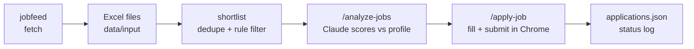

# jobfeed-ai

AI-assisted job shortlisting and applications, built on top of the [`jobfeed`](https://www.npmjs.com/package/jobfeed) job-discovery CLI.

`jobfeed` finds jobs and exports them to Excel. `jobfeed-ai` reads those files, filters them to relevant roles, has Claude Code score each job against your profile, and then fills and submits the application forms in your own Chrome.

- **No API key.** Scoring and applying run inside Claude Code on your Claude plan; the browser work goes through the Claude in Chrome extension.
- **No fabrication.** Every form value comes from your profile or an answer you gave. Anything missing is asked, never guessed.
- **No double applies.** Every outcome is logged, and a job already marked `submitted` is never applied to again.

## How it works



| Step | Command | Output |
| --- | --- | --- |
| Fetch | `npm start -- fetch` | `data/input/<date>/*.xlsx` |
| Shortlist | `npm start -- shortlist` | `data/output/shortlist-<date>.json` |
| Score | `/analyze-jobs` (Claude Code) | `data/output/analysis-<date>.md` |
| Apply | `/apply-job` or `/apply-all` (Claude Code) | `data/output/applications.json` |

`npm start -- run` chains all four.

## Requirements

- **Node.js 23.6+** (runs TypeScript directly, no build step)
- **Google Chrome**
- **[Claude Code](https://claude.com/claude-code)** on a paid Claude plan (Pro or higher)
- **Claude in Chrome** extension, signed in with the same Claude account

## Setup

```bash
npm install
cp .env.example .env
```

`npm install` also installs the git hooks. Editing `.env` is optional; the defaults work.

Install the Claude in Chrome extension and keep Chrome open:

```bash
npm start -- open "https://chromewebstore.google.com/detail/claude/fcoeoabgfenejglbffodgkkbkcdhcgfn"
```

Create your candidate profile at `profiles/candidate-profile.json` and put your resume under `private/` (see [Candidate profile](#candidate-profile)).

## Usage

### Full pipeline

```bash
npm start -- run
```

Fetches jobs, writes the shortlist, then starts Claude Code with `/apply-all`. It scores the shortlist and applies to each `apply` job in turn, highest score first. It stops and asks when it needs you: a login, OTP or CAPTCHA, a fact your profile doesn't have, or a drafted free-text answer to approve. At the end it prints a summary table with a status for each job.

### Step by step

```bash
npm start -- fetch --choice 3   # 1 = daily jobs, 2 = remote companies, 3 = both
npm start -- import             # check rows and columns per Excel sheet
npm start -- shortlist          # filter to relevant roles
```

Then, in Claude Code in this folder:

```text
/analyze-jobs                   # score the shortlist, write the ranked report
/apply-job                      # apply to the next best unapplied "apply" job
/apply-job https://...          # apply to a specific job link
/apply-all                      # apply to every "apply" job in the latest report
```

### CLI reference

| Command | Description |
| --- | --- |
| `fetch [--choice 1\|2\|3]` | Run `jobfeed` and save its Excel files into the input folder |
| `import` | List each Excel sheet with its row count and column names |
| `shortlist` | Dedupe jobs and keep early-career web roles open to India |
| `run` | `fetch` + `shortlist`, then hand over to Claude Code (`/apply-all`) |
| `open <url>` | Open a link in your default browser, to apply by hand |
| `browser [url]` | Open Chrome with the dedicated Playwright profile (`private/browser-profile`) |

`--input <dir>` reads Excel files from another folder (`fetch`, `import`, `shortlist`). Run `npm start` with no command to print usage.

## Shortlist rules

The shortlist is a cheap rule filter in [src/jobs/prefilter.ts](src/jobs/prefilter.ts) that runs before any Claude scoring. A job is kept when:

- the title matches a web or full-stack role (frontend, React, Next.js, Node, MERN, SDE, software engineer, …),
- the title is not senior, lead, manager, intern, SDE-2/3, or asking for 3+ years,
- the location is empty or open to India (India, remote, worldwide, APAC, …).

Duplicate job URLs across files are dropped. Edit the regexes there to target other roles.

## Candidate profile

`profiles/candidate-profile.json` is the only source for form values. It is gitignored. Top-level fields:

| Field | Used for |
| --- | --- |
| `personal`, `address`, `links` | Contact fields on forms (never sent to the scoring report) |
| `currentJob`, `experience`, `education`, `projects`, `achievements`, `summary` | Work-history fields and drafted answers |
| `skills`, `yearsOfExperience` | Scoring and skill questions |
| `jobPreferences` | Titles, work modes, locations, notice period, CTC, work authorization |
| `resumePath` | Resume upload, e.g. `./private/resume.pdf` |
| `minimumMatchScore` | Jobs scoring below this are marked `skip` |
| `customAnswers` | Answers to recruiter questions, saved automatically after you answer them once |

## Application behaviour

- Opens each job in a new tab of your everyday Chrome, follows the Apply button to the company's form (Greenhouse, Lever, Workday, Ashby, …) and fills it from your profile.
- Submits on its own when every value is already known. Stops for missing facts, drafted answers, logins, OTPs and CAPTCHAs. It never types passwords, creates accounts or solves CAPTCHAs.
- Marks a job `submitted` only after it sees a confirmation. Other statuses: `skipped`, `failed`, `login_required`, `manual_action_required`, `verification_required`.
- Logs every result to `data/output/applications.json`, which is also the duplicate check.

## Configuration

| Variable | Default | Description |
| --- | --- | --- |
| `JOBFEED_INPUT_DIR` | `./data/input` | Where `jobfeed` writes Excel files and `jobfeed-ai` reads them |
| `BROWSER_PROFILE_DIR` | `./private/browser-profile` | Chrome profile for the `browser` command (holds login cookies) |

## Project structure

```text
.claude/skills/        Claude Code skills: analyze-jobs, apply-job, apply-all
src/
  index.ts             CLI entry point and commands
  config/settings.ts   Paths from environment variables
  jobfeed/runner.ts    Runs the jobfeed CLI non-interactively
  excel/               Excel file discovery and row reading (ExcelJS)
  jobs/                Row-to-job normalization, dedupe, shortlist rules
  browser/             Playwright Chrome launcher for the browser command
tests/                 Unit tests (node:test)
data/input/            jobfeed Excel output (gitignored)
data/output/           Shortlists, analysis reports, applications.json (gitignored)
profiles/              Candidate profile (gitignored)
private/               Resume and browser profile (gitignored)
```

## Development

```bash
npm test                          # all unit tests
node --test tests/jobs.test.ts    # one test file
npm run typecheck                 # tsc, no emit
```

Git hooks (husky):

- **pre-commit** runs `npm run typecheck` and `npm test`.
- **commit-msg** enforces Conventional Commits: `type(scope): description`, e.g. `feat(jobs): add location filter`.

## Privacy

Job data, your profile, resume and browser profile stay on your machine and are excluded from Git by `.gitignore`. The scoring report contains only skills and experience, never contact or address details. Never commit `.env`, `profiles/`, `private/` or `data/`.

## Troubleshooting

| Problem | Fix |
| --- | --- |
| `/apply-job` says no browser is connected | Install Claude in Chrome, sign in with the same Claude account, keep Chrome open |
| `fetch` warns a section failed | `jobfeed` saved the other sections; check the listed files and rerun later |
| `browser` says the window is already open | Use the open window, or close it and rerun |
| Shortlist is empty | Run `npm start -- import` to check the Excel columns, then loosen the rules in `prefilter.ts` |

## License

ISC
